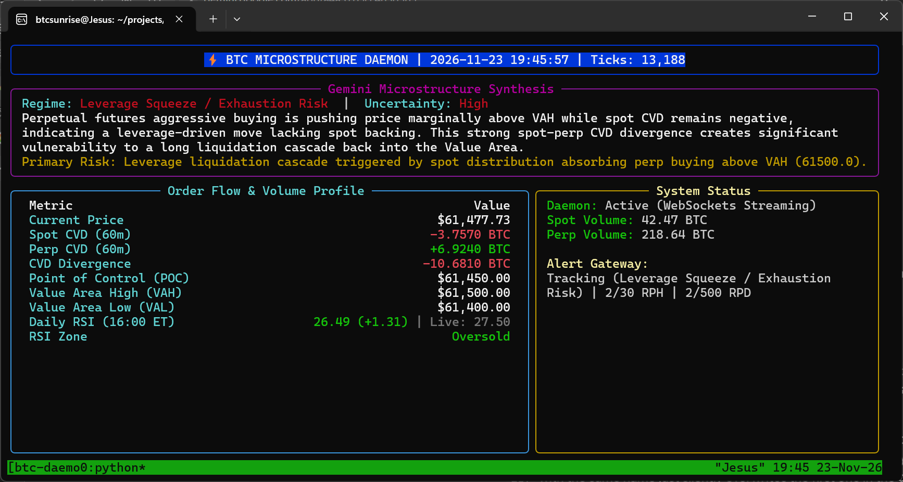

# Bitcoin Weekday Intel

Tuesday, 11/24/2026

## Strategic News

Macroeconomic liquidity conditions reflect a stark cross-asset divergence over the trailing 24 hours as U.S. equities staged an explosive relief rally while digital assets and precious metals faced renewed selling pressure. Following Monday's news of Jensen Huang's reinstatement as CEO of Nvidia, the tech-heavy Nasdaq Composite surged **+6.5%** (and the Dow jumped 1,448 points), yet Bitcoin failed to sustain its sympathy bounce—fading sharply from an intraday high near **$64,505–$64,603** back beneath **$60,000** during Asian and European trading on Tuesday. Market makers note that booming AI equity valuations and elevated 10-year Treasury yields (~4.92%) make it easier for the Federal Reserve to proceed with a **25 bps rate hike** at the December 8–9 FOMC meeting (currently priced at ~95%–100% on CME FedWatch, lifting the target range from 3.75%–4.00% to 4.00%–4.25%). Concurrently, spot gold sealed its worst 60-day decline in 44 years (-24.6%), highlighting broad liquidity stress across non-yielding hard assets.

Direct sovereign balance-sheet liquidity support remains on its scheduled Thanksgiving holiday pause. With no secondary debt buybacks scheduled this week following last Friday's $4.0 Billion 7Y–10Y settlement, primary dealer desks look ahead to Tuesday, December 1, for the Treasury’s next preliminary CUSIP eligibility announcement ahead of a major **$12.5 Billion** nominal coupon buyback on December 2.

## Institutional ETF Flows & Liquidity Absorption

U.S. Spot Bitcoin ETFs extended their net redemption streak to five consecutive sessions on Monday, November 23, logging **-$569.74 Million** in net outflows even as U.S. tech stocks surged. Daily trading volume across the funds reached **$3.53 Billion**, while combined net assets contracted to **$74.12 Billion**.

* **Net Daily Flow (Nov 23):** -$569.74 Million (~9,400 BTC net redeemed).
* **Monthly Drawdown Context:** Cumulative November net outflows have now climbed to approximately **-$4.57 Billion to -$4.80 Billion** since October 30, effectively matching or surpassing June 2026's all-time monthly redemption record (-$4.51B).
* **Corporate Balance-Sheet Offset:** Offsetting a fraction of secondary ETF selling, Strategy disclosed in a Form 8-K filing that it acquired **457 BTC** between November 16 and November 22, bringing its total corporate treasury holdings to **851,305 BTC**, alongside a newly raised $4.0 Billion share buyback ceiling.

## On-Chain Settlement & Cohort Dynamics

On-chain settlement metrics reveal deep holder capitulation alongside a major contraction in derivatives leverage:

* **Long-Term Holder Loss Realization:** On-chain telemetry from CryptoQuant and Glassnode shows the **Long-Term Holder Spent Output Profit Ratio (LTH-SOPR)** fell 0.20 over the past week to **0.76**—its lowest reading in 90 days—after touching **0.67** on Monday (its second-lowest print of 2026). LTH-SOPR has now remained below 1.0 for 22 consecutive days (with **STH-SOPR at 0.99** for 26 straight days), indicating that long-term wallets (>155 days) are realizing average losses of ~33%–35% on spent coins. Historically, comparable LTH-SOPR capitulation waves (such as July 1, 2026, near $60,024) have marked exhaustion points near cyclical floors.
* **Supply Underwater & Futures Contraction:** Less than half of circulating Bitcoin supply (**47.3%**) remains in profit, leaving **52.7%** underwater or near breakeven—well below the **Short-Term Holder Cost Basis ($74,000–$81,000)** and the **200-week moving average (~$67,800)**. Simultaneously, total Bitcoin futures open interest fell **12% week-over-week to $29.30 Billion** (and coin-denominated OI dropped 10.2% to 639,900 BTC), confirming that structural futures leverage has been aggressively unwound.
* **Two-Sided Volatility & Liquidations:** Monday's failed spike to **$64,505** followed by Tuesday's slide to **$59,380–$59,404** triggered **$826.18 Million** in crypto-wide liquidations over the trailing 24 hours ($348M longs / $478M shorts), flushing late breakout chasers on both sides of the order book.

---

## 48-Hour Macro & Liquidity Catalyst Calendar

| Date / Time (UTC) | Event / Data Release | Consensus / Previous | Direct Impact on BTC / Risk Liquidity |
| --- | --- | --- | --- |
| **11/24 15:00 UTC** | **U.S. Conference Board Consumer Confidence (Nov)** | **99.5** *(Prev: 98.7)* | Household spending outlook and inflation expectations benchmark. |
| **11/24 18:00 UTC** | **U.S. $70.0B 5-Year Note Auction** | **4.74% WI** | Mid-curve sovereign yield absorption test ahead of holiday liquidity thinning. |
| **11/25 13:30 UTC** | **U.S. Weekly Initial Jobless Claims** | **221K** *(Prev: 220K)* | Pre-Thanksgiving labor market pulse tracking employment tightness. |
| **11/25 13:30 UTC** | **U.S. Durable Goods Orders (Oct)** | **+0.2% MoM** *(Prev: -0.7%)* | Capital expenditure gauge tracking industrial credit demand. |
| **11/25 15:00 UTC** | **U.S. Personal Income, Spending & Core PCE (Oct)** | **+0.3% MoM Core** | The Fed's preferred inflation gauge—critical input for the Dec 9 FOMC hike. |

---

## Important Variables

*Data gathered at 11:30 UTC*

| Variable | Value | Notes / Status |
| --- | --- | --- |
| **Bitcoin Spot Price** | **$59,745.68** | Slipped back below $60k after failing to hold Monday's $64,505 squeeze |
| **Bitcoin 24-hour change in price** | **-2.47%** | Reversing yesterday's bounce as -$569.7M ETF outflows weigh on order books |
| **Aggregated 24h Spot Volume** | **$38.45 Billion** | Elevated turnover driven by Monday's $5,100 intraday round-trip swing |
| **Bitcoin Market Dominance** | **58.9%** | Easing slightly from 59.6% as select majors decouple on equity bounce |
| **7-Day Price Range** | **$55,130 – $65,119** | Wide range bounded by Saturday's 2-year low and Monday's failed spike |
| **Upper Resistance Level (Last 24h)** | **$64,505.00** | Monday's Nvidia-driven intraday peak that met heavy spot ETF supply |
| **Lower Resistance Level/Support (Last 24h)** | **$59,380.00** | Intraday Asian/European support low guarding a retest of $57,700–$55,130 |
| **Total Open Interest (OI)** | **$29.30 Billion** | Down 12% WoW (639.9K BTC coin-OI) following $10.7B 2-week liquidation flush |
| **Long/Short Ratio (Binance/OKX)** | **0.96 (49.0% Longs)** | Slight net-short tilt following failed breakout above $64,500 |
| **Predicted Funding Rate** | **+0.0018%** | Compressed near-zero baseline funding reflecting clean leverage reset |
| **24h Liquidations (Long / Short)** | **$142.6M / $195.8M** | Two-sided BTC liquidations ($826M crypto-wide) from $64.5k to $59.4k whipsaw |

---

## General Market Summary

Over the past 24 hours, Bitcoin suffered a sharp failed breakout, surging briefly from **$61,258** to an intraday peak of **$64,505.00** in sympathy with Monday's **+6.5%** Nasdaq rally on Nvidia CEO news, before reversing nearly **-8%** to touch an intraday low of **$59,380.00** and trading near **$59,745.68** during European morning trade on Tuesday.

Microstructure telemetry confirms that persistent institutional spot withdrawals continue to cap relief rallies despite thoroughly flushed futures leverage. U.S. Spot Bitcoin ETFs posted another **-$569.74 Million** in net outflows on Monday—pushing cumulative 30-day redemptions past **-$4.57 Billion**—while on-chain metrics show the **Long-Term Holder SOPR** falling to a 90-day low of **0.76** (and **0.67** on Monday) with **52.7% of circulating supply** sitting underwater. In the derivatives complex, total futures open interest has contracted **12% week-over-week to $29.30 Billion** (following $10.7 Billion in two-week crypto-wide liquidations), and Monday’s violent **$5,125** round-trip whipsaw liquidated **$826.18 Million** across crypto venues ($348M longs / $478M shorts), leaving the **Predicted Funding Rate (+0.0018%)** compressed and the **Long/Short Ratio (0.96)** slightly net-short. With markets pricing near-certainty on a December Fed rate hike ahead of Wednesday's **Core PCE** inflation print and holiday liquidity thinning into Thursday's Thanksgiving break, reclaiming and holding **$60,400–$61,200** is required to stabilize order books and prevent a secondary liquidity probe toward **$57,700** and Saturday’s **$55,130** cyclical trough.

## BTCSunrise Comments

The BTC Microstructure display returns and on my side it is now sending me alerts. I woke up this morning to messages on my phone showing the back and forth stuggle with the derivitices shortin ginto liquidiation and the leveraged longs also liquidating in a real back and forth battle. Here is the new v1.5 version of the btc-alert-system. You can get a copy for yourself on github.

The improvements I made are some bug fixes that prevented most alerts from going out, and adding in RSI. The Relative Strength Index should give readers a better understanding of the market so that they can make better trades. Let me explain.

### Relative Strength Index

The **Relative Strength Index (RSI)** is a technical momentum indicator—often compared to a speedometer for market prices—that measures how fast and how strongly an asset's price is moving on a scale from 0 to 100. Developed by J. Welles Wilder Jr. in 1978, the RSI typically looks back over the last 14 periods and compares the average size of recent price gains against the average size of recent price losses. When buyers push prices higher consistently, average gains outweigh losses and the RSI climbs toward 100; when sellers dominate, it drops toward 0; and readings near 50 signal a balanced market where neither side has a clear edge.

In traditional stock trading, traders usually calculate a 14-day RSI from each day's market close to spot when a stock has moved too far, too fast. An RSI reading above **70** is generally considered **overbought**, warning that a rally may be losing steam and due for a pullback, while a reading below **30** is considered **oversold**, suggesting heavy selling may soon stabilize or bounce. Stock traders also watch the **50 centerline** to confirm trend direction—readings holding above 50 point to bullish momentum, while readings below 50 point to bearish momentum—and look for **divergences**, where a stock makes a new price high or low that the RSI fails to confirm, as an early warning that a trend may be ready to reverse.

Applying RSI to Bitcoin requires a structural adjustment because crypto markets run 24/7 with no official closing bell. While standard crypto charts often calculate daily RSI at midnight UTC, **btcsunrise.com** tracks a **14-period Wilder RSI anchored to 16:00 ET (4:00 PM Eastern Time)**—aligning directly with the traditional U.S. equity close, when Wall Street liquidity and spot Bitcoin ETF flows settle for the day. Rather than treating RSI as a standalone buy-or-sell trigger, we pair this 16:00 ET daily momentum gauge with live order-flow telemetry—including Cumulative Volume Delta and Volume Profiles—giving traders a clear read on both macro daily momentum and real-time buying or selling pressure without getting whipsawed by overnight noise.
